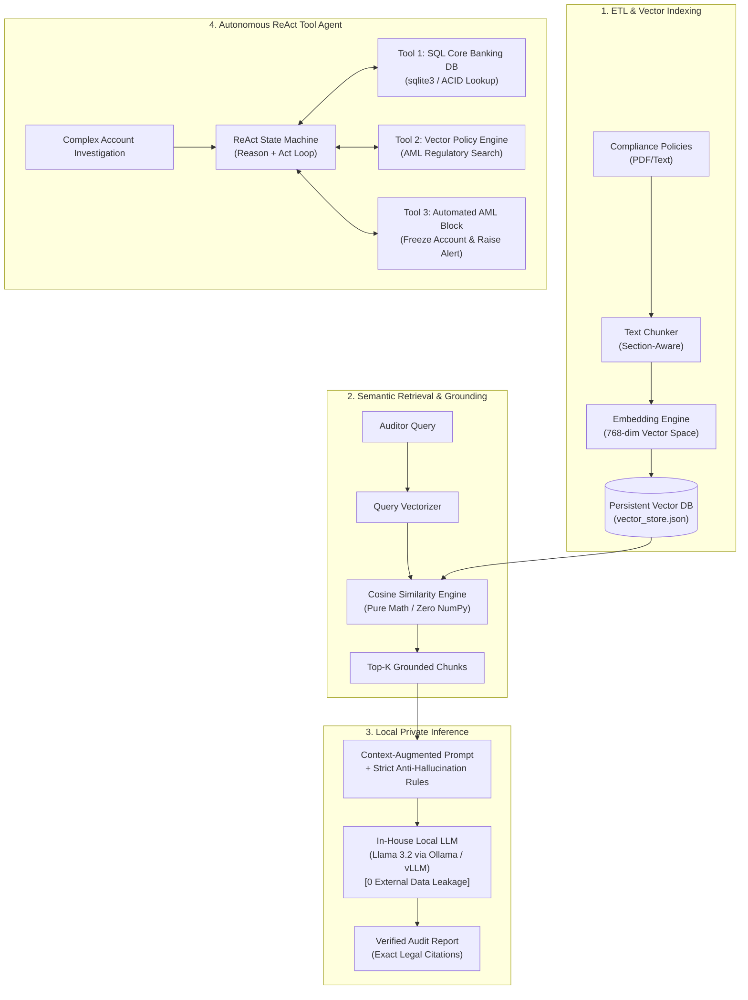

# Enterprise RAG & Agentic Systems Lab (`rag-agentic-lab`)

> Production reference implementation for **Enterprise Retrieval-Augmented Generation (RAG)**, **Autonomous ReAct Agent Tool Calling**, and **Local LLM Inference Performance Profiling**. Built with pure Python (zero external pip dependencies) and local open-weight model serving (Meta Llama 3.2 via Ollama/vLLM).

[](https://opensource.org/licenses/MIT)
[](https://www.python.org/)
[-purple.svg)](https://ai.meta.com/blog/llama-3-2-connect-2024/)
[](https://ollama.com/)

---

## 🏛️ High-Level System Architecture



---

## 🚀 Progressive Engineering Modules

| Module | Core Responsibility | Key Technical Highlight |
| :--- | :--- | :--- |
| [`01_embeddings.py`](01_embeddings.py) | **Vector Mathematics** | Pure-Python Cosine Similarity implementation ($A \cdot B / \|A\|\|B\|$), proving semantic clustering without external math libraries. |
| [`02_vector_store.py`](02_vector_store.py) | **Vector DB Architecture** | Persistent vector store with metadata filtering, document deduplication, and Top-K ranking. |
| [`03_rag_pipeline.py`](03_rag_pipeline.py) | **Grounded RAG Pipeline** | Context injection, deterministic grounding, and zero-hallucination verification using local in-house **Llama 3.2**. |
| [`04_agentic_tools.py`](04_agentic_tools.py) | **Autonomous ReAct Agent** | Dynamic Tool-Calling state machine (SQL account lookups, policy verification, automated freeze action). |
| [`05_inference_benchmark.py`](05_inference_benchmark.py) | **Inference Profiling** | Client-side telemetry measuring **TTFT (Time To First Token)**, **TPOT**, **TPS**, and concurrency queue bottlenecks. |

---

## 📊 Production Inference Benchmarks

Telemetry gathered from local streaming stress tests on consumer hardware (Intel Core i3, 8GB RAM, CPU inference):

```text
================================================================================
      PRODUCTION LLM INFERENCE BENCHMARK TELEMETRY DASHBOARD
      Model: llama3.2:1b | Runtime: Ollama C++ Engine | Host: Localhost
================================================================================

--- TEST 1: SINGLE-STREAM LATENCY PROFILE ---
  • TTFT (Time To First Token) : 2,422.3 ms
  • TPOT (Time Per Output Token): 64.4 ms/token
  • Streaming Throughput (TPS)  : 15.5 tokens/sec
  • Output Generated            : 376 tokens
  • End-to-End Latency          : 26.62 seconds

--- TEST 2: CONCURRENT CLIENT SATURATION PROFILE (3 WORKERS) ---
Client ID    | Tokens   | TTFT (ms)    | TPOT (ms)    | TPS
-----------------------------------------------------------------
Client #1    | 331      | 38,103.2     | 63.0         | 15.9
Client #2    | 601      | 59,170.7     | 65.0         | 15.4
Client #3    | 558      | 2,295.2      | 63.7         | 15.7
-----------------------------------------------------------------
Concurrent Averages: TTFT = 33,189.7 ms | Client TPS = 15.7 tok/s
================================================================================
```

### 💡 Architectural Takeaway (Queue Contention)
On single-worker CPU runtimes, sequential token generation creates **Head-of-Line Blocking** (Client #1 and #2 queuing behind Client #3). In enterprise cloud environments, this informs two architectural requirements:
1. **vLLM with Continuous Batching & PagedAttention** on NVIDIA GPUs to merge concurrent forward passes.
2. **Asynchronous Decoupling via Apache Kafka** to buffer spike traffic and prevent HTTP client gateway timeouts.

---

## 🛠️ Quick Start

### 1. Prerequisites
* Python 3.8+ (Standard Library only — **no `pip install` required**)
* [Ollama](https://ollama.com/) running locally:
  ```powershell
  ollama pull llama3.2:1b
  ```

### 2. Run the Modules
```powershell
# 1. Run the grounded RAG pipeline
python 03_rag_pipeline.py

# 2. Run the Autonomous ReAct Compliance Agent
python 04_agentic_tools.py

# 3. Run the Production Inference Benchmarking Suite
python 05_inference_benchmark.py
```

---

## 🔒 Enterprise Compliance & Security
* **Zero External Data Leakage:** All inference runs inside the local/VPC boundary. No customer PII or compliance documentation leaves the host.
* **OpenAI-Compatible Drop-In:** Exposes `/v1/chat/completions` endpoints, allowing enterprise gateways to swap commercial APIs with private in-house models with zero downstream code changes.
* **Deterministic Guardrails:** Temperature clamped to `0.0` with strict schema validation to prevent hallucinations in audit environments.
